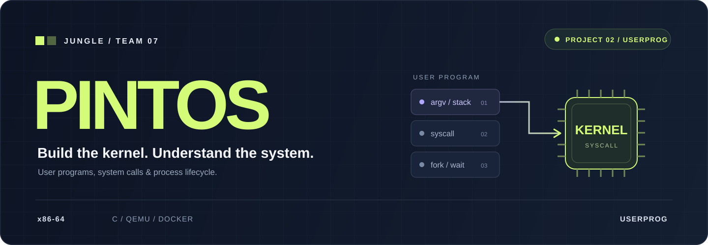

<p align="center">
  
</p>

<div align="center">

### 🌱 사용자 프로그램에서 커널까지, 실행의 경계를 이해합니다.

**KRAFTON JUNGLE · WEEK 08 · TEAM 07**

프로그램을 실행하고, 시스템 콜을 연결하고, 프로세스의 생명주기를 관리합니다.<br />
64비트 Pintos 위에서 사용자 공간과 커널의 관계를 직접 구현하고 검증합니다.

**[🧩 Issues](https://github.com/Pintos-W8-T7-User/pintos_22.04_lab_docker/issues)** &nbsp; / &nbsp;
**[🔀 Pull Requests](https://github.com/Pintos-W8-T7-User/pintos_22.04_lab_docker/pulls)** &nbsp; / &nbsp;
**[📘 KAIST Manual](https://casys-kaist.github.io/pintos-kaist/)** &nbsp; / &nbsp;
**[📝 PR Template](.github/pull_request_template.md)** &nbsp; / &nbsp;
**[🚀 Quick Start](#quick-start)**

</div>

<br />

## 🛠️ What we're building

이번 주의 초점은 **Project 2 — User Programs**입니다.
사용자 프로그램이 커널의 기능을 안전하게 이용하고, 프로세스가 실행부터 종료까지 올바르게 동작하도록 구현합니다.

<table>
  <tr>
    <td width="33%" valign="top">
      <h3>🚀 01 / RUN PROGRAMS</h3>
      <strong>프로그램 실행</strong>
      <p>명령행 인자를 해석하고 초기 사용자 스택을 구성해 프로그램 실행으로 연결합니다.</p>
      <sub>Argument Passing · User Stack · Loading</sub>
    </td>
    <td width="33%" valign="top">
      <h3>🔐 02 / CROSS THE BOUNDARY</h3>
      <strong>시스템 콜과 파일 접근</strong>
      <p>사용자 주소와 버퍼를 검증하고, 입출력과 파일 연산을 커널 기능에 연결합니다.</p>
      <sub>System Calls · Validation · File Descriptors</sub>
    </td>
    <td width="33%" valign="top">
      <h3>🔄 03 / MANAGE PROCESSES</h3>
      <strong>프로세스 생명주기</strong>
      <p>프로세스 생성·실행·대기·종료를 구현하고 부모·자식 동기화와 자원 정리를 검증합니다.</p>
      <sub>fork · exec · wait · exit</sub>
    </td>
  </tr>
</table>

위 구분은 프로젝트의 기능 영역입니다. 개인별 담당 배정은 별도로 합의합니다.
<br />

## ⚙️ Built on a shared stack

| Layer | Stack | Purpose |
|:---|:---|:---|
| Architecture | x86-64 | KAIST Pintos의 64비트 커널 환경 |
| Language | C · Assembly | 사용자 프로그램 로딩·시스템 콜·프로세스 관리 |
| Toolchain | GCC · GNU Make · GDB | 빌드와 디버깅 |
| Runtime | QEMU | 커널 실행과 테스트 |
| Workspace | Ubuntu 22.04 · Docker · VS Code Dev Containers | 팀이 공유하는 개발 환경 |

환경 설정은 [Dockerfile](.devcontainer/Dockerfile)과 [devcontainer.json](.devcontainer/devcontainer.json)에 있습니다.
<br />

## 🤝 Three developers. One system.

**작은 변경을 일찍 공유하고, 공통 인터페이스와 실행 흐름을 함께 검증합니다.**

| 개인 브랜치 | 담당 기능 | 관련 이슈 | 마감 |
|:---:|:---|:---|:---|
| JE | 미정 | 미정 | 미정 |
| YYJ | 미정 | 미정 | 미정 |
| YJH | 미정 | 미정 | 미정 |

구현 범위를 3분할한 뒤 개인별 마감일을 정합니다.
공통 함수·구조체·동기화 조건과 파트 간 의존성을 먼저 합의합니다.

<table>
  <tr>
    <td width="50%" valign="top">
      <h3>📌 함께 맞출 것</h3>
      <p>함수의 인자·반환값, 부모·자식 상태, 파일 디스크립터 관리 방식, 메모리 소유권, 락 순서와 자원 해제 책임을 공유합니다.</p>
    </td>
    <td width="50%" valign="top">
      <h3>🔍 함께 확인할 것</h3>
      <p>각 담당은 기능 테스트와 실패 분석을 책임집니다. 공통 코드 변경과 파트 간 연결에서 발생한 실패는 관련 담당이 함께 확인합니다.</p>
    </td>
  </tr>
</table>
<br />

## 🌿 Five branches. One workflow.

원격 브랜치는 **main · develop · JE · YYJ · YJH** 다섯 개를 유지합니다.

| 브랜치 | 역할 | PR 대상 |
|:---:|:---|:---:|
| main | 통합 검증한 결과 | — |
| develop | 팀 작업 통합 | main |
| JE | 개인 작업 | develop |
| YYJ | 개인 작업 | develop |
| YJH | 개인 작업 | develop |

<div align="center">

**JE · YYJ · YJH** &nbsp; → &nbsp; **PR → develop** &nbsp; → &nbsp; **통합 검증 → PR → main**

</div>

- 개인 브랜치는 최초에 `develop`에서 생성합니다.
- 작업 시작 전과 PR 병합 전 최신 `develop`을 개인 브랜치에 merge합니다.
- 충돌은 개인 브랜치에서 해결하고 관련 테스트를 다시 실행합니다.
- 병합 방식은 **merge commit**을 사용합니다.
- 개인 브랜치는 계속 재사용하며 병합 후 삭제하지 않습니다.
- `main`, `develop`에 직접 Push하거나 강제 Push하지 않습니다.
- 이슈를 해결하는 작은 단위로 PR을 나눕니다.

<details>
<summary><strong>💻 개인 브랜치 동기화 예시</strong></summary>

작업 내용을 먼저 커밋해 작업 트리를 정리합니다.
아래 `JE`는 본인 브랜치 이름으로 바꿉니다.

```bash
git fetch origin
git switch JE
git merge --ff-only origin/JE
git merge origin/develop
```

충돌이 발생하면 파일을 수정한 뒤 merge를 완료합니다.

```bash
git add <해결한_파일>
git commit
```

이후 관련 테스트를 실행하고 개인 브랜치를 올립니다.

```bash
git push origin JE
```

`--ff-only`가 실패하면 로컬과 원격의 분기 상태를 확인합니다. 강제 Push로 덮어쓰지 않습니다.

</details>
<br />

## 👀 Review together. Merge responsibly.

| 권한 | 인원 | PR 병합 기준 |
|:---|:---:|:---|
| Admin | 2명 | 승인자가 0명이어도 본인 PR 병합 가능 |
| Write | 1명 | 다른 팀원의 승인 1명 필요 |

- `main`, `develop`은 PR을 통해 변경합니다.
- Admin은 PR에서 승인 규칙을 우회할 수 있도록 설정합니다.
- 승인이 필수가 아닌 경우에도 관련 담당에게 리뷰를 요청합니다.
- 실제 병합 충돌은 승인 수와 관계없이 먼저 해결합니다.
- 실패 테스트와 공통 코드 영향은 병합 전에 공유합니다.
- 리뷰에서 제기된 문제는 해결 여부와 후속 조치를 남깁니다.
- CI와 이슈 자동 배정은 추후 도입합니다.
<br />

## 📝 Commit with context.

첫 줄은 **변경 목적과 결과**, 본문은 **파일별 변경 함수와 설명**으로 작성합니다.

```text
사용자 인자 전달 구현 및 초기 스택 구성

process.c / Update: load(), setup_stack() / 인자 배치와 스택 정렬 처리

관련 이슈: #번호
```

| 항목 | 규칙 |
|:---|:---|
| 첫 줄 | 변경 목적과 결과를 한국어로 요약 |
| 본문 | `파일 / 변경 종류: 함수·항목 / 변경 설명` |
| 변경 종류 | `Create`, `Update`, `Delete`, `Fix` |
| 파일 구분 | 파일마다 줄을 나누고 같은 파일의 함수는 쉼표로 구분 |
| 줄 번호 | 필요할 때만 작성 |
| 관련 이슈 | 관련 이슈가 있으면 번호 기록 |
| 변경 단위 | 하나의 커밋에는 설명 가능한 하나의 목적 |

- 문서·설정 변경은 함수 대신 수정한 항목을 적습니다.
- PR 제목도 변경 목적을 요약하는 한국어 문장으로 작성합니다.
- Git이 생성하는 merge commit 메시지는 그대로 사용할 수 있습니다.
<br />

## 💬 Explain the reason in code.

기존 코드의 들여쓰기·중괄호·이름 규칙을 따릅니다.
새 함수나 의미 있게 수정한 처리 블록에는 필요한 설명과 본인 브랜치를 남깁니다.

```c
/* [YYJ] 사용자 버퍼가 페이지 경계를 넘을 수 있어
 * 접근하는 전체 범위를 검사한다. */
```

후속 작업은 담당 브랜치와 관련 이슈를 함께 기록합니다.

```c
/* TODO [JE] #번호: fork 실패 경로의 자원 정리 검증. */
```

- 브랜치 표기는 `JE`, `YYJ`, `YJH`를 사용합니다.
- 주석은 동작의 의도, 주의할 조건, 동기화 이유를 설명합니다.
- 필요한 곳에 입력 조건·반환값·메모리 소유권·락 보유 조건을 적습니다.
- 단순 대입처럼 코드만으로 명확한 내용에는 주석을 강제하지 않습니다.
- 기존 라이선스와 유효한 설명 주석은 유지합니다.
- 관련 없는 파일 전체 포맷 변경을 섞지 않습니다.
- 불필요한 디버깅 출력은 제거하고 과제에서 요구하는 출력은 유지합니다.
<br />

## 🤝 Shared code, shared understanding.

- 공통 함수·구조체를 바꾸기 전에 이슈나 PR에서 변경 범위를 공유합니다.
- 같은 파일을 수정할 때는 담당 함수와 수정 위치를 먼저 맞춥니다.
- 다른 PR에 의존하면 선행 PR과 병합 순서를 기록합니다.
- 충돌 해결 시 상대 코드의 변경 의도를 확인합니다.
- 실패 테스트는 이름·증상·실행 환경을 기록합니다.
- 남은 작업은 이슈로 남기고 담당자와 후속 조치를 정합니다.
<br />

## 🧪 Quality is part of the work.

현재 기본 테스트 설정은 다음 영역을 포함합니다.
아래 내용은 검증 범위이며 현재 통과 결과를 의미하지 않습니다.

| Test group | What we check |
|:---|:---|
| User Programs | 인자 전달, 시스템 콜, 사용자 메모리 접근, 프로세스 동작 |
| File System Base | 파일 생성·읽기·쓰기와 기본 파일 시스템 동작 |
| No-VM | 가상 메모리 확장 전 환경의 자원·메모리 동작 |
| Threads Regression | 기존 스레드·동기화·스케줄링 동작의 회귀 |

`dup2` 추가 과제는 현재 기본 설정에서 비활성화되어 있습니다.

서로의 구현이 만나는 경계는 함께 확인합니다.

| Integration check | 확인할 연결 |
|:---|:---|
| 프로그램 실행 → 인자 전달 | 명령행 해석, 사용자 스택, 실행 진입 |
| 시스템 콜 → 사용자 메모리 | 주소·문자열·버퍼 범위 검증 |
| fork → 파일·메모리 복제 | 부모·자식 자원과 실패 경로 |
| wait → exit | 종료 상태 전달, 대기·종료 순서 |
| exec → 자원 정리 | 실행 이미지 교체와 자원 생명주기 |

검증 결과는 **PASS / FAIL / 미실행**으로 기록합니다.
실패 원인과 미실행 이유를 적고, 미구현 기능의 실패와 기존 동작의 회귀를 구분합니다.
<br />

## ✅ Before opening a PR.

[PR 템플릿](.github/pull_request_template.md)은 새 PR의 기본 본문입니다.
각 PR에서 내용을 수정하고 해당 없는 항목은 `없음`으로 표시합니다.

- [ ] PR 목적과 관련 없는 변경을 섞지 않았습니다.
- [ ] 관련 이슈와 담당 브랜치를 기록했습니다.
- [ ] 커밋 메시지에 변경 목적과 파일별 변경 내용을 기록했습니다.
- [ ] 필요한 코드 주석에 브랜치 표기와 동작 이유를 작성했습니다.
- [ ] 최신 대상 브랜치를 반영하고 충돌을 해결했습니다.
- [ ] 빌드·관련 테스트 결과와 실패·미실행 이유를 기록했습니다.
- [ ] 공통 함수·구조체 변경과 다른 담당에게 미치는 영향을 설명했습니다.
- [ ] 불필요한 디버깅 출력·생성 파일·인증 정보를 제외했습니다.

커밋마다 템플릿 파일 자체를 수정할 필요는 없습니다.
체크리스트는 작성자의 확인 기록이며 자동 검사는 아닙니다.
<br />

<a id="quick-start"></a>

## 🚀 Quick Start

### 1. 팀 저장소 가져오기

호스트 터미널에서 실행합니다.

```bash
git clone https://github.com/Pintos-W8-T7-User/pintos_22.04_lab_docker.git
cd pintos_22.04_lab_docker
git switch develop
```

개인 작업을 시작할 때 본인 브랜치로 전환합니다.

```bash
git switch JE
```

`JE`는 본인 브랜치인 `JE`, `YYJ`, `YJH` 중 하나로 바꿉니다.

### 2. 개발 컨테이너 열기

1. Docker를 실행합니다.
2. VS Code에서 저장소의 최상위 폴더를 엽니다.
3. Dev Containers 확장을 설치합니다.
4. 명령 팔레트에서 **`Dev Containers: Reopen in Container`**를 실행합니다.

컨테이너에는 Git·GCC·Make·GDB·QEMU가 설치됩니다.

### 3. 빌드와 테스트

**컨테이너 안의 터미널에서 저장소 내부에 위치한 상태로** 실행합니다.

```bash
cd "$(git rev-parse --show-toplevel)"
source pintos/activate
cd pintos/userprog
make
make check
```

테스트 결과는 `pintos/userprog/build/results`와 각 테스트의 `.result`, `.output`, `.errors`에서 확인합니다.

<details>
<summary><strong>🔧 환경·디버깅 메모</strong></summary>

- 실행 환경은 `linux/amd64` 기반 Ubuntu 22.04입니다.
- 기존 로컬 폴더 이름이 `_User`로 끝나면 실제 해당 경로를 사용합니다.
- Dockerfile의 자동 활성화 경로는 기본 폴더 이름을 사용합니다. 폴더 이름이 다르면 위 명령처럼 저장소 루트에서 `source pintos/activate`를 직접 실행합니다.
- `pintos` 명령을 찾지 못하면 `pintos/activate`를 실행했는지 확인합니다.
- 실행 권한 오류가 나면 `pintos/utils`의 실행 스크립트 권한을 확인합니다.
- 줄바꿈은 저장소의 `.gitattributes`를 따릅니다.
- 전체 파일이 변경으로 표시되면 실제 코드 차이와 줄바꿈 차이를 구분합니다.
- 환경 문제를 공유할 때는 실행 위치·명령·오류 로그를 함께 기록합니다.

</details>
<br />

## 🧭 Read the code. Trace the state.

```text
pintos_22.04_lab_docker/
├── .devcontainer/          # 팀 개발 환경
├── .github/
│   └── pull_request_template.md
├── assets/                 # README 시각 자료
├── pintos/
│   ├── userprog/           # 프로그램 로딩·시스템 콜·프로세스 관리
│   ├── include/            # 구조체·공통 인터페이스
│   ├── threads/            # 스레드·스케줄러·동기화
│   ├── filesys/            # 파일·파일 시스템
│   ├── lib/                # 커널·사용자 공통 라이브러리
│   ├── tests/
│   │   ├── userprog/       # Project 2 테스트
│   │   ├── filesys/        # 파일 시스템 테스트
│   │   └── threads/        # Project 1 회귀 테스트
│   └── vm/                 # 후속 가상 메모리 확장
└── README.md
```

처음 읽을 코드:

**[process.c](pintos/userprog/process.c)** → **[syscall.c](pintos/userprog/syscall.c)** → **[exception.c](pintos/userprog/exception.c)**

함께 확인할 공통 인터페이스:

**[thread.h](pintos/include/threads/thread.h)** · **[process.h](pintos/include/userprog/process.h)** · **[file.h](pintos/include/filesys/file.h)**
<br />

## 📚 Learning is a deliverable.

과제 목적 → 필요한 개념 → 자료구조 → 상태 변화 → 실제 코드 → 테스트를 연결합니다.

구현은 직접 하고, AI는 개념 설명·힌트·코드 읽기·리뷰·디버깅에 활용합니다.
테스트가 확인하는 동작과 실패 원인을 자기 말로 설명하는 것까지 학습 목표에 포함합니다.

| Team record | 기록 위치 |
|:---|:---|
| 역량 목표 수립 | 해당 `[WEEK8]` 이슈 |
| 업무 검토·담당·마감 | 관련 작업 이슈 |
| 역량 달성률 평가 | 해당 `[WEEK8]` 이슈 |
| 팀 협업 규칙 합의 | 협업 룰 이슈와 README |
| What I Learned | 해당 `[WEEK8]` 이슈 |

진행 상황은 [팀 Issues](https://github.com/Pintos-W8-T7-User/pintos_22.04_lab_docker/issues)에서 관리합니다.
개인별 구현 범위와 마감일은 합의 후 갱신합니다.
<br />

---

<div align="center">

**🌴 JUNGLE TEAM 07**<br />
<sub>Build together. Understand together.</sub>

<br /><br />

<sub>Based on <a href="https://github.com/casys-kaist/pintos-kaist">KAIST Pintos</a> and the <a href="https://github.com/krafton-jungle/pintos_22.04_lab_docker">Krafton Jungle Docker environment</a>.<br />
원본 및 수정 코드의 라이선스는 <a href="pintos/LICENSE">pintos/LICENSE</a>를 따릅니다.</sub>

</div>
